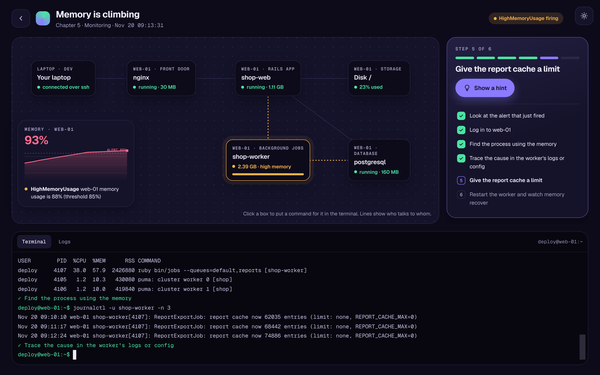

# DevOps Simulator

Learn DevOps by fixing a (fake) production system in your browser. You get a
terminal, logs and dashboards for a small online shop, and things go wrong:
the disk fills up, memory leaks, a deploy breaks the site. Nothing is real,
so you can't break anything.



## Chapters

| # | Topic      | Chapter                | Status      |
|---|------------|------------------------|-------------|
| 1 | GitHub     | Open your first pull request | playable |
| 2 | CI         | Works on my machine    | playable    |
| 3 | Deploy     | The health check is lying | playable |
| 4 | Linux      | The disk is full       | playable    |
| 5 | Monitoring | Memory is climbing     | playable    |

Each chapter can be played on its own, and each ends with a short note on the real incident or practice it's based on.

## Running it

In one terminal:

```sh
cd backend
bundle install
bin/rails db:prepare
bin/rails server        # API on http://localhost:3000
```

In another:

```sh
cd frontend
npm install
npm run dev             # open http://localhost:5173
```

Tests and checks: `cd backend && bin/rails test && bin/rubocop`, `cd frontend && npm run lint && npm run build`.

## Trying the API

```sh
curl -s -X POST localhost:3000/api/runs -H 'Content-Type: application/json' -d '{"scenario":"linux-disk-full"}'
curl -s -X POST localhost:3000/api/runs/1/commands -H 'Content-Type: application/json' -d '{"input":"ssh web-01"}'
curl -s -X POST localhost:3000/api/runs/1/tick
```

Live updates for a run are broadcast on the `RunChannel` (Action Cable, `/cable`, param `run_id`).

## Deploying to Render

The repo has a `Dockerfile` that builds the frontend and serves it from Rails, so
the whole app is one web service. `render.yaml` describes it as a Render Blueprint:

1. In Render, choose **New > Blueprint** and pick this repository.
2. Render reads `render.yaml`, creates the `devops-sim` web service on the free plan
   and generates `SECRET_KEY_BASE`. Every push to `main` deploys again.

The app runs as one Puma process, so Action Cable uses its built-in async adapter
and no Redis is needed. Runs are saved in SQLite under `storage/`. The free plan has
no persistent disk, so saved runs are lost on each deploy or restart. To keep them,
use a paid plan and attach a disk at `/rails/storage`.
